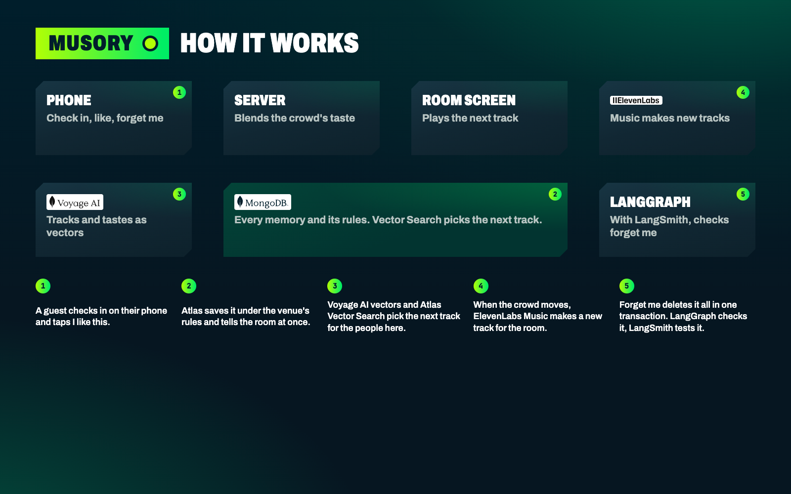
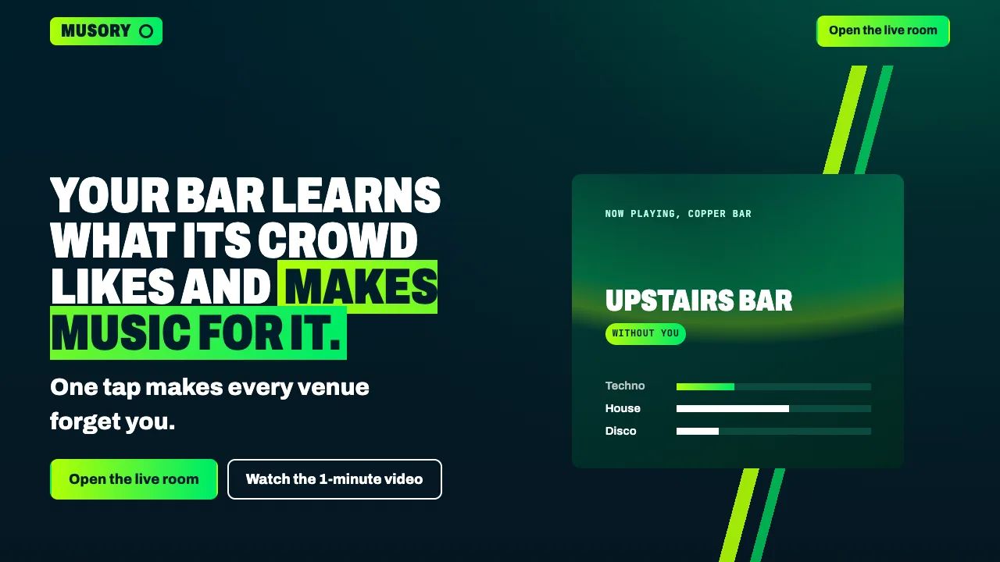
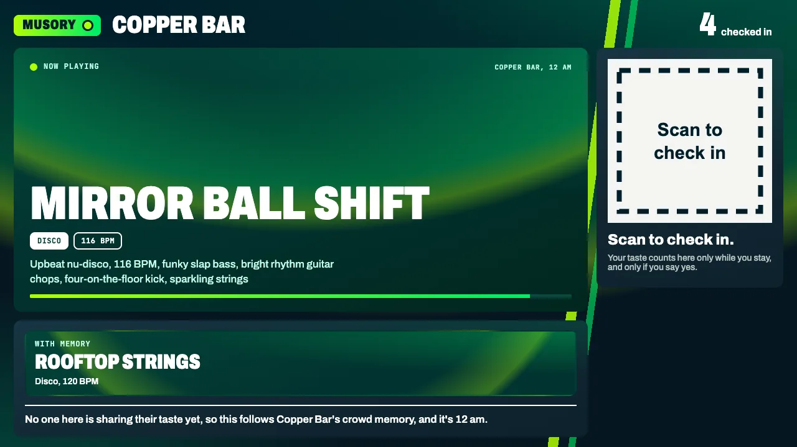
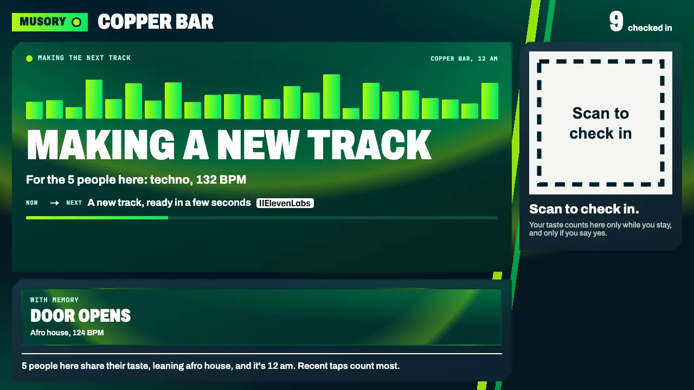
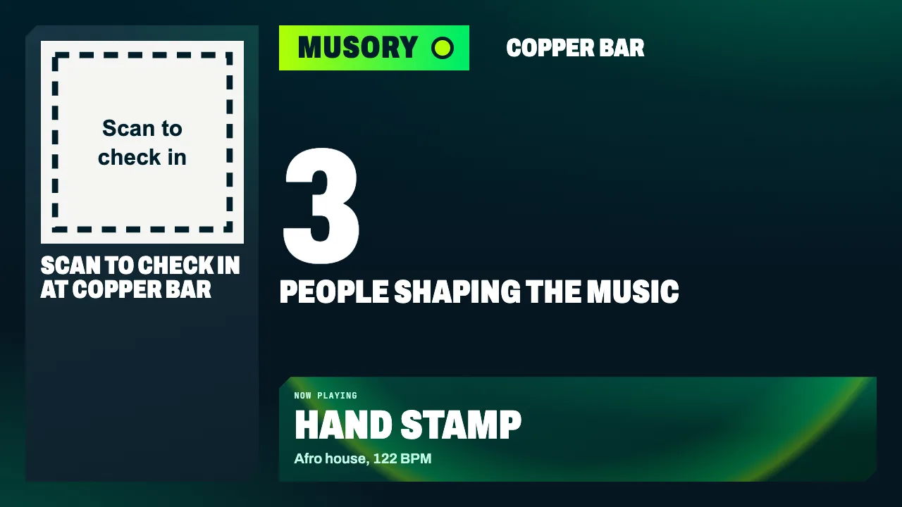
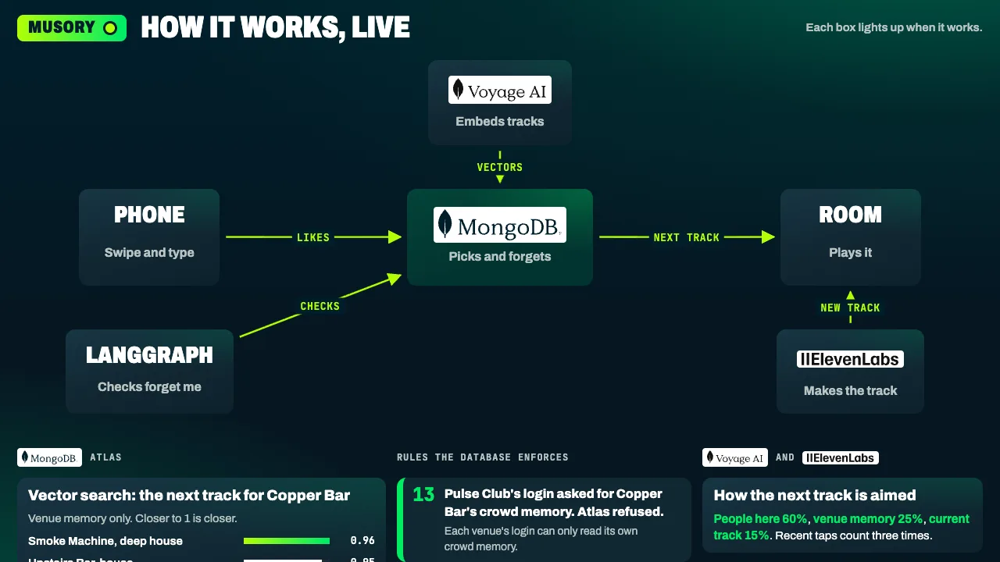
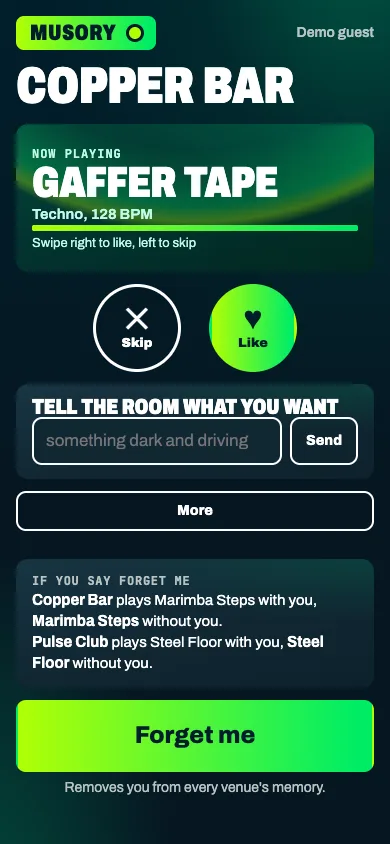
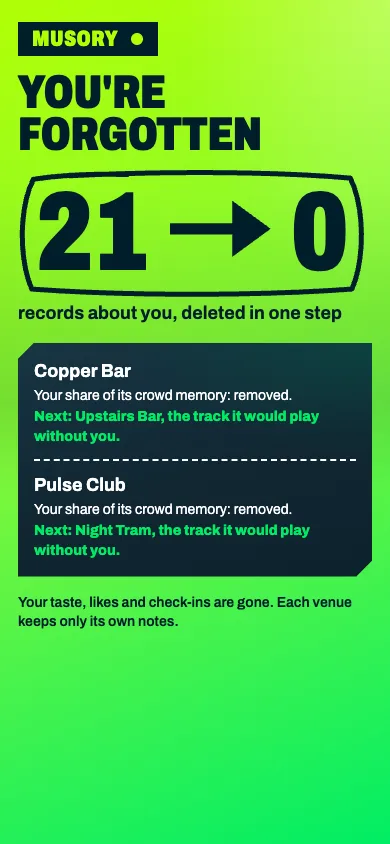

# Musory

**Bars play one playlist for everyone, and the apps that let guests shape the music keep their likes on view with no easy way to take them back.**

**Your bar learns what its crowd likes and makes music for it. One tap makes every venue forget you.**

Bars and clubs play one playlist for everyone. I love electronic music. Not everyone does.

## What a guest does

1. Scan the venue's QR code and choose what to share.
2. Swipe the track that's playing: right to like, left to skip. Or type what you want, like "upbeat, with more bass". The room picks its next track from the people there.
3. When the crowd's likes shift, ElevenLabs Music makes a new track for them and the room crossfades into it.

## What forget me does

One tap deletes your likes and taste at every venue in one transaction. Crowd memory is rebuilt without them, and our copies of tracks made from them are deleted.
Afterwards the checked collections hold 0 records with your guest id, and the room chooses without your taste. `GET /api/number` recomputes this live, and `pnpm smoke` checks it end to end. Backups, the oplog, the text-free receipt and copies the music provider keeps are outside that zero.



- **Watch the 1-minute video:** https://youtu.be/Q6TSA8ha3UM
- **Try it:** watch the 1-minute video to see it.

Toronto nightlife is shrinking ([CBC](https://www.cbc.ca/radio/costofliving/canada-nightlife-decline-9.6993902)), so venues need guests to come back. This is a prototype with simulated venues. A venue pilot would test whether guests prefer its choices.

## The three questions, answered

- **How do you keep one venue's memory from leaking into another's?** Each venue has its own database login that can read only its own View. Pulse Club reading Copper Bar's crowd memory is refused by Atlas (error 13). Crowd memory needs 3 or more people and holds no guest ids.
- **How do you fix or drop a memory that's wrong or expired?** Skip it, or "Play something different" to set old likes aside (with Undo). "Only count my likes tonight" expires with Atlas TTL, and tracks made for the room expire after closing. Forget me deletes your likes, taste and the tracks made from them in one transaction, and rebuilds crowd memory without you.
- **How do you prove memory changed behaviour?** Every pick is saved next to the pick the same search makes with no memory, and the room shows both. No language model picks tracks. In our scripted test, memory changed the pick in 8 of 9 scenarios, and a guest who didn't consent changed nothing.

## Built during the hackathon

Musory was built on November 14, 2026 at Agents in Context Toronto. Every commit in this repository is from that day (the first at 13:52 EST), so the commit history shows exactly what was made during the event. Open-source libraries are listed in `package.json`. The music is generated with ElevenLabs Music, and the track embeddings with Voyage AI.

## Screens

| | |
|---|---|
|  |  |
| The landing page. | The room screen: now playing, the next track with memory, and how to check in. |
|  |  |
| The room makes a new track when the crowd moves it. | The stage screen for a projector: check in, and how many people shape the music. |
|  |   |
| How it works, live: each box lights up when its step runs. | The guest page (swipe to like or skip, or type what you want), and forget me ticking off each step as it finishes. |
|  | |
| The receipt after forget me, with a fresh start or done. | |

## What it does

- **A guest** scans the venue's QR code, checks in, and says yes or no to two things: "use my taste here while I'm checked in" and "add my taps to this venue's crowd memory". Then they tap **I like this**, **Not for me** or **Bored of this** on whatever is playing. No mic, no listening, no guessing at mood: only explicit taps.
- **The room** (a laptop or screen at the venue) plays the next track picked from the people in the room, the venue's own crowd memory and the current track. It shows the pick next to the pick it would make with no memory at all.
- **Your night** on the guest page lists what the room played while you were checked in, from the room's own play log: no microphone, no song recognition.
- **Your taste is yours.** It goes with you to any venue you check into, so there's no cold start, and a venue uses it only while you're there.
- **Each venue's crowd memory is private.** Copper Bar can't read Pulse Club's, and neither can read your raw taps. Atlas refuses (error 13).
- **Forget me** deletes your taste, your taps, your check-ins, and your share of every venue's crowd memory, in one transaction. The receipt shows the count going to 0, and both rooms choose again without your taste.
- **The room makes a new track when the crowd moves it.** When guests' taps change a room's leading sound, the room asks ElevenLabs Music for a new 15-second track at its current tempo (a composition plan that eases from the current sound into the new one) and crossfades into it over about 3 seconds, with filter sweeps. The screen says "Making a new track from this room's shared taste", then "Made just now for this room". If the new track takes more than 10 seconds, the room plays the closest track from its catalogue and says so.

Venues (Copper Bar, Pulse Club), guests and track titles are fictional. The catalogue is 19 instrumental clips generated with ElevenLabs Music from descriptions of genre, tempo and sound only.

## How the next track is picked

No model picks the track. The server blends three layers of memory into one query vector and runs Atlas Vector Search over Voyage embeddings of each clip's description:

| Layer | What it is | Owner | Weight in the query |
|---|---|---|---|
| Guests' taste | Each checked-in guest's taste vector, built only from their own taps. Anyone who just checked in or tapped in the last 2 minutes counts 3 times | The guest | 60% |
| Crowd memory | This venue's reactions from guests who agreed, as one aggregate of 3 or more people. Crowd records hold no guest ids. Source tap ids let us remove your share and are hidden from venue logins | The venue | 25% |
| The current track | Keeps the set moving smoothly | | 15% |

The search is exact (`$vectorSearch` with `exact: true`), pre-filtered on the demo clock's energy target and a BPM range around the current track, and skips anything played recently. Every pick is stored with the pick the same search makes with no memory (the current track alone), so "memory changed the pick" is computed, not claimed.

## The three questions, answered by the database

| Question | Rule | Enforced by | Proof (live) |
|---|---|---|---|
| How do you keep one client's memory from leaking into another's? | Each venue reads its own crowd memory through its own database login and View. Venue logins can't read guests' taps or taste | Atlas database users with `read` on one View each | Pulse Club's login reading Copper Bar's View: **13 Unauthorized**. A venue login reading `taps`: **13** |
| How does the agent fix or drop a memory that is wrong or expired? | **Bored of this** marks your likes of the current sound `superseded` (kept, with who and when; Undo restores them). **Tonight only** keeps taps out of your long-term taste unless you tap "Keep this one". **Forget me** removes everything | A transaction for bored and undo; a `constraint`-level validator on taste; one transaction with `$graphLookup` for forget me | A tonight-only tap written into long-term taste: **121**. Forget me: **N to 0** |
| How do you prove memory changed behavior? | Each pick is logged next to the no-memory pick. Before forget me, the guest's page shows what each room will play without them, from the same function forget me is checked against | Decisions in `derived`; the headline number | After forget me, each room's now-playing equals the promised "without you" track |

Other rules the database enforces (`validationLevel: "constraint"`, error 121 otherwise):
- A venue's crowd memory needs at least 3 different people. With fewer, only the pick is kept.
- A guest's taste can be built only from that guest's own taps.
- Venue memory (crowd memory, decisions, notes) can't hold a guest's id.
- One reaction per guest per play (unique index, E11000).
- Taps get an expiry no later than 180 days after they are made. TTL removes expired records asynchronously, and check-ins and tonight-only sessions expire too.

## Everything lives in MongoDB

Tracks made from guests' taste are stored inside MongoDB, so forget me deletes the sound itself in the same transaction, and closing time deletes it automatically (a TTL index on the clip records, which Atlas runs asynchronously, usually within a minute or two). The 19 catalogue clips are stored there too, each in its track document; `GET /api/audio/<id>` streams every sound from Atlas, and only the shared catalogue clips may be cached.

## How fast it is (measured on the Atlas sandbox, 2026-11-14)

- A guest checks in and their taste changes the room: the room plays a track made for it about 4 seconds later (ElevenLabs takes about 2.5 seconds of that).
- Five simulated guests tap a new sound: a new track made for the room is playing about 6 seconds later.
- Forget me: the room crossfades to a track chosen without the guest about 2.3 seconds after the request, and the full receipt arrives about a second later, once the pick has been recomputed from what is left in the database. With the durable follow-up checks on (they run after the room has changed), it was about 2.5 seconds.

## "What was that track?"

A guest can type a few words about something they heard ("rolling bassline, fast") and get the track back. The words are embedded with Voyage and matched against the clips' descriptions with Atlas Vector Search, then the top results are reordered by Voyage's reranker (`rerank-3`, through the Voyage API). In a test with 20 descriptions we wrote, the right track came first 18 times with the reranker, 17 times without it, and 11 times with keyword search or with `$rankFusion` combining keyword and vector search, so the hybrid search is not used. That was the only alternative we tried, with no tuning. The reranker orders catalogue matches. When tracks made for the room are mixed in, results are ordered by vector score. Turn it on with `FIND_TRACK=1` (and `FIND_RERANK=1` for the reranker).

## Checks that run on their own

- **The follow-up to forget me.** Forget is one transaction. The follow-up checks run as a LangGraph job with a MongoDB checkpointer, so once started they finish even if the server restarts. A crash in the fraction of a second after the delete commits can skip the follow-up check, never the delete. Turn it on with `FORGET_GRAPH=1`.
- **Evaluations (LangSmith).** `EVAL_ALLOW_RESET=1 pnpm eval` runs scripted scenarios through LangSmith `evaluate()` against the running server (it resets the demo data), with plain-code checks and no model grading; with `LANGSMITH_API_KEY` set the experiment is uploaded, without it the run stays local. It checks that forget me reaches 0 records; Pulse Club is refused Copper Bar's crowd memory; a tonight-only tap never enters long-term taste; a guest who did not consent changes nothing; nothing about a forgotten guest is left in the job's checkpoints.

## How forget me reaches every copy

Crowd memory holds no identities, so how does forget me find your share? Each crowd memory document lists the tap ids it was built from (`derivedFrom`), and taps belong to the guest. Forget me starts at your taps and runs `$graphLookup` over `derivedFrom`: depth 0 finds your taste and every venue's crowd memory you fed. Past picks are not deleted: the transaction removes your taste's reference from them. In one transaction it deletes your taps, taste, check-ins, consents, tonight sessions and bored records, rebuilds each crowd memory from the taps that remain (removing it if fewer than 3 people are left), unlinks your taste from past decisions, and writes a text-free receipt (an HMAC of your id plus counts). Then both rooms re-pick and play the new pick at once.

## Sponsor tech, and what each one does

| Sponsor | Product | What it does in Musory | Where |
|---|---|---|---|
| MongoDB | Atlas (system of record) | Keeps every tap, taste, crowd memory, pick and play | `server/db.ts`, `server/room.ts` |
| MongoDB | Atlas Vector Search | Chooses the next catalogue track and the fallback: an exact `$vectorSearch` with the room's blend (guest taste, venue memory and the current track) as the query. ElevenLabs can compose the next track instead. Also finds "What was that track?" from a guest's own words | `server/room.ts`, `server/find.ts` |
| MongoDB | Atlas Search index | Keyword search over track titles and descriptions, kept as the comparison for "What was that track?" | `server/find.ts`, `scripts/setup-vector.ts` |
| MongoDB | Change streams | Move the room screens: a new pick or play saved in Atlas is what changes the screen and the music | `server/index.ts` |
| MongoDB | Database users and Views | One login per venue. A venue can read only its own crowd memory, never another venue's or any guest's taps (refused with 13) | `scripts/setup-db.ts` |
| MongoDB | Schema validation | Atlas enforces the stored memory rules (the app checks consent and supplies the source fields). It refuses memory that breaks a rule, such as a crowd memory from fewer than 3 people or a tonight-only like saved as long-term taste (refused with 121) | `scripts/setup-db.ts` |
| MongoDB | Unique index | One reaction per guest per play (refused with E11000) | `scripts/setup-db.ts` |
| MongoDB | TTL indexes | Taps get an expiry no later than 180 days, check-ins and tonight-only sessions expire, and tracks made for a room expire at closing. TTL removes them asynchronously | `scripts/setup-db.ts`, `server/expiry.ts` |
| MongoDB | Transactions and `$graphLookup` | Forget me follows what was built from a guest's taps: one commit deletes their records and the clips made from them, rebuilds crowd memory, and removes their taste's reference from past picks | `server/room.ts` |
| MongoDB | Audio in documents | Every track, including the ones made for a room, is stored in Atlas, so the forget me transaction deletes our audio bytes with the clip record | `server/index.ts`, `server/music.ts` |
| Voyage AI | `voyage-4` | Turns each track's written description, and a guest's own words, into vectors. Catalogue embeddings are cached in Atlas | `server/embed.ts`, `server/find.ts` |
| Voyage AI | `rerank-3` (Voyage API) | Re-orders the top 5 catalogue matches for "What was that track?" (right track first in 18 of 20 test descriptions, 17 without it). Mixed catalogue and new-track results use vector scores | `server/find.ts` |
| ElevenLabs | Music (`music_v2_5`) | Makes a new 15-second track from the room's shared taste when the crowd's taps move it, from genre, tempo and texture words only. The 19 catalogue clips were also made with ElevenLabs Music | `server/music.ts` |
| LangChain | LangSmith evaluations | Scripted scenarios run against the real server with plain-code checks: 9 of 9 uploaded scenarios passed (no trace of a forgotten guest in the checked collections, and each room chose without them). The run (9 completed of 14 planned) is kept in the team's LangSmith project, and the latest result shows on the app's proof page. | `scripts/eval.ts` |
| LangChain | LangGraph with the MongoDB checkpointer | Forget is one transaction. Its follow-up verification runs as a LangGraph job checkpointed in Atlas and can resume after a restart once saved | `server/forget-graph.ts` |

## Run it

```bash
pnpm install
cp .env.example .env      # fill in the Atlas host, logins, Voyage and ElevenLabs keys
pnpm setup:db             # collections, validators, indexes, Views, track embeddings
pnpm setup:vector         # Vector Search index on tracks
pnpm setup:audio          # stores catalogue clips (public/audio/tNN.mp3, if you have the files) in their track documents
pnpm start                # http://localhost:4377/
pnpm smoke                # end-to-end checks against the running server
```

- **Start here:** `http://localhost:4377/` lists the steps. Rooms: `/room/copper`, `/room/basement`. Guest page: `/join/copper`. Proofs: `/proof`.
- **Phones on the same Wi-Fi:** `pnpm lan` serves on the laptop's LAN address and puts it in the QR codes. Some guest Wi-Fi blocks phone-to-laptop traffic; then open `/p/<guest>` tabs on the laptop.
- **Database users** are created in Atlas (UI, CLI or Admin API), not by the driver: the app user with `readWrite` and `dbAdmin` on `edmRoom`, and one user per venue with `read` on that venue's View only.
- **Reset:** `POST /api/reset` (regulars from last weekend), or `POST /api/film/reset` (adds a demo guest with techno taste who hasn't checked in yet, and four quiet guests in Copper Bar).
- **Live music:** start with `MUSIC_LIVE=1 pnpm start`. Without it, rooms play the catalogue only.
- **Room controls** (reset, skip, simulated guests, proofs) work only from the laptop itself; through a tunnel or from another device they return 403.

## What's simulated and what isn't

- **Real:** every sound streams from Atlas. Every database rule, refusal, transaction, change stream and vector search above runs live on Atlas. The clips are real ElevenLabs Music generations. The embeddings are real Voyage calls. Catalogue embeddings are cached in Atlas, and the words a guest types are not stored by our app.
- **Simulated:** the venues, their regulars from "last weekend" and the guests are seeded. A **Simulated guests** button makes five seeded guests like two samples of one sound, so the room can be shown without phones; it is labelled as simulated on screen. The time of night is a demo clock ("Next hour"). Clips are 15 seconds, so a room's set moves fast. "Tonight only" lasts 2 minutes in the demo.
- **Not built:** real venue sound systems or DJ software; the room plays clips in a browser. Transitions are crossfades (1 second between catalogue tracks, about 3 seconds with filter sweeps into a new track), not beat-matched mixing.
- **Limits we know about:** Atlas backups and the oplog keep data for their own retention windows; the validator checks what the server writes onto a document (it trusts the copied owner ids). TTL expiry runs asynchronously, not instantly. A pick reveals a little about who is in the room. Live composition sends ElevenLabs only genre, tempo and texture words from the room's blend, never anything about a guest. A composed track's record keeps the room's mix, the number of people behind it (3 or more) and the tap ids it was built from, so the forget me transaction deletes our audio bytes with the clip record; copies ElevenLabs keeps under its own terms are outside this app's reach. The demo process limits generation attempts in memory, so the limit resets on restart. The normal cooldown between new tracks has exceptions for the stage button and for a guest's typed vibe.

## Prior art

- Rockbot already remembers guests' favourite songs across its venues, and TouchTunes and Rockbot let guests vote on what plays. Carrying taste between venues is not new; consent per venue, private crowd memory and forget-me across every venue are what this adds.
- Spotify's "exclude from your taste profile" and Taste Profile controls change recommendations "within 48 hours" or "a few hours", for one listener.
- Taste APIs such as Qloo model taste across domains; Musory keeps taste with the person and lets them take it back.

## What's next

**Personal mode.** Your phone plays a version made for your own taste, in your earbuds, while the room plays the crowd's mix. It follows the same rules: it counts only while you're checked in, and forget me deletes it everywhere.

## License

MIT. See [LICENSE](LICENSE).
